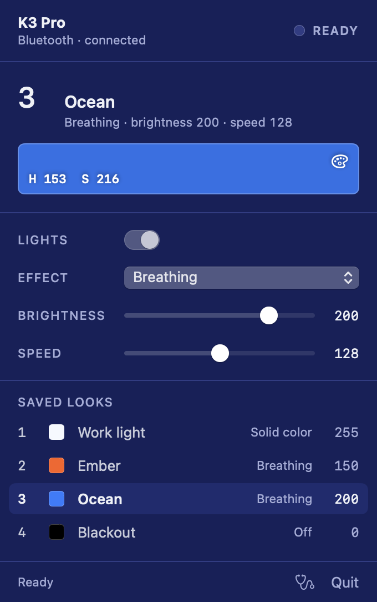

# KeyGlow

**Wireless RGB lighting control for the Keychron K3 Pro, from your Mac's menu bar.**



Keychron's VIA and Launcher can only change the lighting over the USB cable. KeyGlow does it **over Bluetooth**.

## How it works (the hack)

Over Bluetooth, your Mac can send the keyboard exactly one thing: the on/off state of the lock lights (Num, Caps, Scroll, Compose, Kana). KeyGlow flips the four lights macOS never uses in a quick, encoded pattern. A small addition to the keyboard's open-source QMK firmware decodes the pattern into lighting commands. Your real Caps Lock state is never touched.

KeyGlow only **sends** these light signals. It never reads what you type. See [docs/PROTOCOL.md](docs/PROTOCOL.md) for the wire format.

## What you need

- A **Keychron K3 Pro, ANSI layout, RGB version** (USB ID `3434:0230`). Other keyboards won't work as-is.
- A Mac running **macOS 14 Sonoma** or later (Apple silicon or Intel).
- A USB-C **data** cable, for the one-time firmware install.

## Install

### 1. Flash the KeyGlow firmware (once, over USB)

> ⚠️ Flashing replaces your keyboard's firmware. It's reversible (see *Going back* below), but you do it at your own risk. Your VIA key remaps and saved lighting reset to defaults.

1. Download `keychron_k3_pro_ansi_rgb_keyglow.bin` from the [latest release](../../releases/latest).
2. Install the flashing tool: `brew install dfu-util`.
3. Put the keyboard in flash mode:
   - plug in the USB cable,
   - slide the switch to **Off**,
   - hold **Esc**, slide the switch to **Cable**, and keep holding Esc for 2 seconds.

   The keyboard stops typing and its lights stay off. If Esc doesn't work, use the reset button under the spacebar keycap instead.
4. Flash it:
   ```bash
   dfu-util -d 0483:df11 -a 0 -s 0x08000000:leave -D keychron_k3_pro_ansi_rgb_keyglow.bin
   ```
5. The keyboard restarts on its own. Unplug it, slide the switch to **Bluetooth**, and re-pair if needed.

You can also use [QMK Toolbox](https://github.com/qmk/qmk_toolbox) instead of `dfu-util`.

### 2. Install the app

1. Download `KeyGlow.zip` from the [latest release](../../releases/latest), unzip it, and move **KeyGlow** to Applications.
2. Open it. KeyGlow isn't notarized by Apple yet, so macOS will block it the first time. Go to **System Settings → Privacy & Security**, scroll down, and click **Open Anyway**.
3. Click the beacon icon in the menu bar. KeyGlow asks for **Input Monitoring**. That's macOS's name for any app that talks directly to a keyboard. Turn it on for KeyGlow, then quit and reopen KeyGlow.

## Use it

- **Status light** (top right): **red · Sending** while a change is on its way, **green · Sent** once it lands, **amber · Needs attention** when something needs you.
- **Color strip**: click it to pick any color.
- **Lights, Effect, Brightness, Speed**: 22 effects, brightness and animation speed.
- **Saved looks**: click one (or press **1–4**) to apply it. If you tweak it, an **Edited** tag appears; click **Update look** to keep the change, or right-click any saved look to save the current look there.
- Each change takes about 2 seconds to reach the keyboard. That's the cost of sending data through lock lights.
- In wireless mode, a brightness below 48 turns the lights off. That's the keyboard's own power saving.

**Diagnostics** (stethoscope icon): flash the keyboard white, or turn on *Signal view* (also **Fn + V** on the keyboard). Keys 1–5 then light up for each raw signal as it arrives.

## Going back to stock firmware

Download `keychron_k3_pro_ansi_rgb_STOCK_via.bin` from the release (Keychron's unmodified VIA firmware, built from the same source), or get the official firmware from Keychron's website. Then flash it the same way as above.

## Build from source

```bash
# App (needs Xcode command line tools)
app/build.sh            # add --zip for a release zip

# Firmware (needs: brew install --cask gcc-arm-embedded)
firmware/build.sh       # clones Keychron's QMK fork at a pinned commit, applies the patch, builds
```

The firmware is a QMK keymap ([firmware/keymap](firmware/keymap)) plus a two-line hook in Keychron's Bluetooth code ([firmware/patches](firmware/patches)). The hook lets the keymap see every lock-light report, even when several arrive at once.

## Known limits

- Only the K3 Pro ANSI RGB is supported. Other Keychron Pro boards could likely be added the same way (PRs welcome).
- The app can't read back the keyboard's state. It shows what it last sent.
- It can't show the battery level: the keyboard doesn't report it over Bluetooth.
- Bluetooth only. Over the cable, use VIA.

## License

The app is MIT ([LICENSE](LICENSE)). The firmware is GPL-2.0-or-later, like QMK ([firmware/LICENSE](firmware/LICENSE)).

Not affiliated with Keychron.
