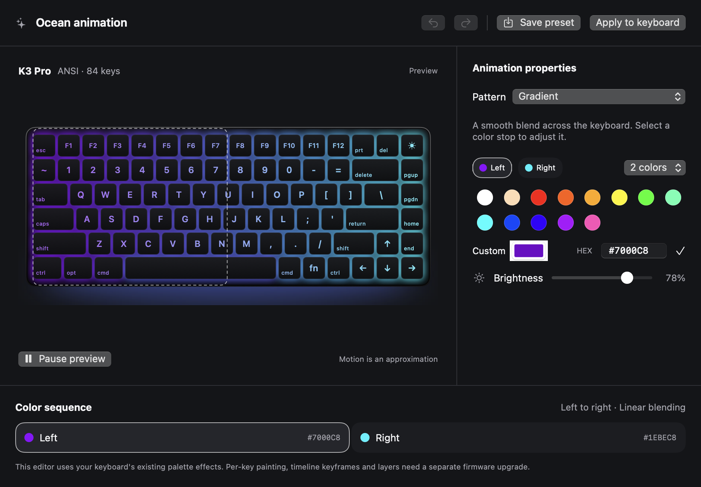

# KeyGlow · Keychron Lighting Studio

A native macOS menu-bar app for controlling a **Keychron K3 Pro ANSI RGB** over Bluetooth, with custom QMK firmware.


## Lighting Studio

- An 84-key keyboard preview with dark keycaps and RGB under-light.
- **Lighting:** color swatches, custom picker, HEX entry, recent colors, brightness and speed.
- **Animations:** 26 supported effects with previews, including split, gradient, color fade and color wave using two or three colors.
- **Presets:** save, apply, rename, update, duplicate, delete, favorite, import and export JSON.
- **Create Animation:** a dedicated palette-effect editor with preview playback, undo/redo, region/color-stop selection, save and apply.
- Diagnostics: flash white, show the keyboard's battery bar, inspect signal bits and adjust transport timing.



Previews show the **selected look**, not a readback from the keyboard. Motion and typing effects are approximate. The keyboard does not acknowledge applied settings. The app distinguishes waiting changes, sending, and completed host writes.

## Requirements

- **Keychron K3 Pro, ANSI RGB**, USB ID `3434:0230`. Other variants are not supported as-is.
- **macOS 14 or later.** The downloadable app is universal (Apple silicon and Intel).
- A USB data cable for the one-time custom firmware installation. Normal lighting control is wireless.

## Install the app

Download **KeyGlow.zip** from [Releases](https://github.com/Sickaada/keyglow/releases), unzip it and put **KeyGlow.app** in Applications. Open it, then click the **keyboard icon** in the menu bar.

The app is ad-hoc signed, not Apple-notarized. macOS may require explicit approval in Privacy & Security before the first launch.

Grant **Input Monitoring to KeyGlow only** in System Settings → Privacy & Security. This is required by the current HID access path. KeyGlow sends output reports and does not register keystroke-input callbacks. Do not grant this permission to your terminal or AI agent on KeyGlow's behalf.

After a rebuild, macOS may require removing and re-adding KeyGlow in that list, then quitting and reopening it. Open only one copy of the app. A development build (`local.keyglow`) and public build (`io.github.sickaada.keyglow`) use separate preferences and permissions.

Saving presets and editing previews work offline. Applying lighting requires the keyboard connection and app permission.

## Firmware setup

The app requires the KeyGlow firmware for **this exact keyboard variant**. Palette effects 22–25 require the firmware included with the Lighting Studio release; older firmware may ignore them.

Flashing replaces the keyboard program and can reset saved key mappings or settings. Export important VIA mappings first, use a reliable cable, and retain a compatible recovery image. Recovery is normally possible through the chip's DFU bootloader, but is not a guarantee against every hardware or flashing failure.

1. Download the matching `keychron_k3_pro_ansi_rgb_keyglow.bin` from the release.
2. Install `dfu-util`: `brew install dfu-util`.
3. Connect USB. Switch **Off**, hold **Esc**, switch to **Cable**, then release Esc after two seconds. In DFU mode the keyboard will not type.
4. Check that DFU sees the intended keyboard:
   ```sh
   dfu-util -l
   ```
5. With the correct device connected, flash:
   ```sh
   dfu-util -d 0483:df11 -a 0 -s 0x08000000:leave -D keychron_k3_pro_ansi_rgb_keyglow.bin
   ```
6. Switch back to Bluetooth and reconnect. Do not unplug during flashing.

To restore, use the appropriate official Keychron firmware or the separately identified source-built stock VIA recovery image. A source-built stock image is not a dump of your keyboard's original firmware.

## Everyday use

- Choose a color or effect; previews update immediately and commands are queued.
- One command takes roughly two seconds with the default transport timing. A complete palette can require several commands.
- In **Presets**, choose **Save current**, enter a name in the inline form and press **Save**.
- For palette effects, choose two or three colors. The larger editor supports the same existing effects; it does not upload arbitrary frame sequences.
- Brightness below 48/255 (about 19%) turns the lighting off on battery.
- The **gear** opens diagnostics. Battery level is displayed on the keyboard, not as an invented percentage in the app.

## How the Bluetooth hack works

The Mac sends standard HID lock-light reports. Four LED bits carry a clock and data; Caps Lock's current state is preserved. The custom firmware decodes short packets into lighting commands and runs effects locally. See [the protocol](docs/PROTOCOL.md).

The transport is intentionally separate from the SwiftUI interface. It sends no per-frame RGB stream and reads no typed keys.

## Build

With Xcode command-line tools installed:

```sh
./app/build.sh --zip
./app/KeyGlow.app/Contents/MacOS/KeyGlow --self-test
```

The build creates `app/KeyGlow.app` and optionally `app/KeyGlow.zip`; binaries are not committed. Local checks cover keyboard geometry, preset storage and import validation, HEX parsing, and pending-submission state. They do not prove physical keyboard outcomes.

For firmware, install Python 3 and the Arm GNU toolchain, then run:

```sh
brew install --cask gcc-arm-embedded
./firmware/build.sh
```

The firmware builder uses Keychron's QMK fork pinned to commit `618127a725a1773e85f13455602cf6f72ab4de17`, the keymap in `firmware/keymap`, and the Bluetooth hook patch in `firmware/patches`. Its work path must not contain spaces. The script builds only; it does not flash a device.

## Scope and limits

Per-key painting, arbitrary timeline keyframes and composited layers are not implemented by the existing protocol. Their [engine requirements](docs/ANIMATION-ENGINE-REQUIREMENTS.md) are documented separately. UI controls for unsupported features are not presented as working features.

Keyboard previews are capped at 30 FPS, honor Reduce Motion and pause when hidden. Effect-card motion is limited to hovered/selected cards; preset thumbnails are static. The source-built release is experimental and should be tested on the exact supported board.

## License

The app is [MIT](LICENSE). The firmware is [GPL-2.0-or-later](firmware/LICENSE), following QMK and Keychron's fork. Not affiliated with Keychron.
